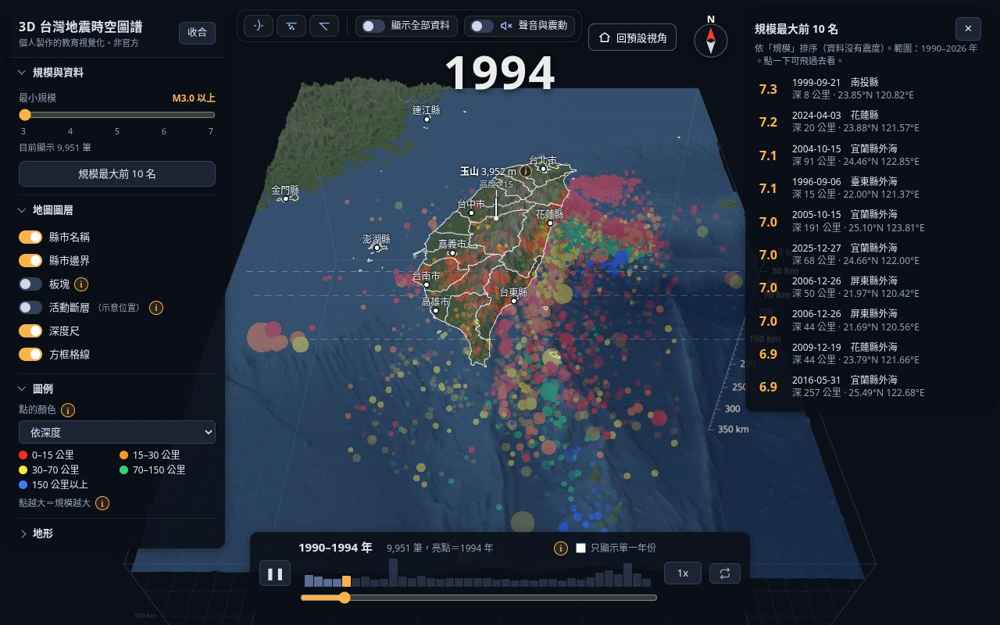
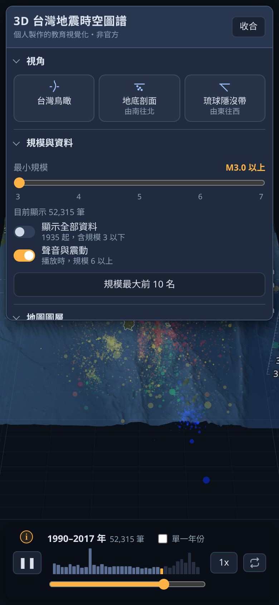
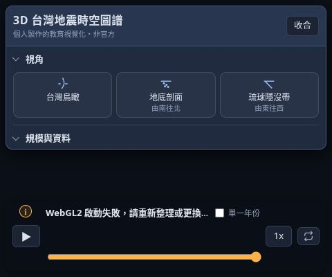

# Phase 2A：穩定性修正與驗證記錄

日期：2026-11-17（Asia/Taipei）。基準 `588cf4a4e3cefc535696fa7facc907d41ed91ede`，工作分支 `codex/phase2a-stability-fixes`，PR 目標 `handoff/full-source-v0510`。

本次沒有修改 main、合併或部署；沒有改 GitHub Pages 設定。沒有更改科學資料、座標換算、深度、地形放大、點大小、色盤、透明混色、資料來源或授權。

## 修改檔案及原因

| 檔案 | 變更 |
|---|---|
| `src/main.js` | 斷層載入完成後採用最新 checkbox 意圖；共用初始化 Promise，避免並行呼叫重複登錄回呼。WebGL 建構失敗時更新可見時間軸文字、alert 與 ready error 狀態，結束 intro，再中止後續初始化。正常 renderer 設定不變。 |
| `src/faults.js` | pick／project 都先更新祖先矩陣，再使用 projection × view × group.matrixWorld；不修改幾何資料或像素命中門檻。 |
| `v0510_check.mjs` | 桌面案例完成後先釋放其 context，再測手機；保留全部斷言與原 timeout。resize 由固定等 1.5 秒改為等待原本 DOM 配置成立，仍用原 20 秒上限。即時輸出結果、失敗退出碼及 finally 關閉瀏覽器。 |
| `vite.config.js`、`scripts/verify-data.mjs`、`scripts/data-sha256.json` | 保留 base `./`；建置前驗證 public/data，完成後驗證 dist/data 的 8 個固定 SHA-256。manifest 不在建置時自動更新。 |
| `scripts/test_fault_world.mjs` | 載入真實 faults 模組，以合成平坦地形與獨立 THREE.Vector3 oracle 驗證 lift=0/35/80、祖先平移／旋轉及隱藏狀態。沒有用相同錯誤的 app project helper 算預期值。 |
| `scripts/test_stability.mjs` | 以可控網路 gate 驗證 cold on→off、on→off→on、單次載入、warm toggle；注入 WebGL 建構失敗並驗證錯誤 UI、intro 移除及無下游 renderer 錯誤。 |
| `scripts/test_data_integrity.mjs` | 用實際 Vite config 的隔離 fixture 驗證 symlink 變文字、漏複製輸出資料都使建置失敗；另驗證損壞 binary 會被 hash guard 攔截。 |
| `scripts/run-tests.mjs` | 本機 npm test 加入上述回歸及既有全量解析等價測試。保留 reg56、v0510、手機底色；實站測試不執行本機 fault-injection fixture。 |
| 本文件及 evidence | 留存前後差異、失敗記錄、最終結果與截圖，供人工審查。 |

## 手機 tap timeout 調查

**證據限定於 Linux Chromium 156＋SwiftShader，不當作 Safari 真機結論。** 沒有改產品音訊程式，也沒有延長 tap timeout。

在未修改的基準產物上執行相同的桌面→手機流程，加入輸入事件記錄與 Playwright trace：

| 情境 | 結果 | 實際觀測 |
|---|---|---|
| 原先保留已完成的桌面場景，同時測手機 | **FAIL，保留** | 30 秒 tap timeout，整段約33.018秒。本次卡在同一行前一個 collapse tap；事件最終送達，面板已展開，但尚未執行聲音 tap。觀測主執行緒長任務12.412／12.740秒；sound=false、tones=0。前次驗收則卡在 sound tap。 |
| 唯一受控差異：桌面檢查後先 close context | PASS | 相同 collapse→sound 與等待序列約17.216秒完成；sound 收到 pointer/touch/click/change，sound=true、tones=2；觀測長任務最大約3.340秒。 |

這提供可重現的「雙軟體 WebGL 場景／測試資源生命週期」干擾輸入證據，不支持直接把失敗歸因於音訊 handler。此 PR 釋放不再使用的測試場景，沒有刪掉並行前已完成的任何桌面檢查，也沒有替換手機 tap 為程式化 click。

**原壓力情境仍標 FAIL。** 沒有 GPU driver CPU trace 足以把每個長任務歸因到特定底層函式，故不宣稱已徹底查明 driver 內部根因或修復產品在所有低資源裝置的效能。原始 A/B log、trace 與原壓力失敗可在交付的證據包重查。

第一輪修正版完整測試又記錄一個 **FAIL**：resize 後 `innerWidth` 已變，但固定1.5秒等待時 `sound/views` 尚未移進 panel（sp=false、vp=false）。目前等待的是原程式 resize handler 真正完成 DOM 配置；原20秒上限與配置斷言保留，若 handler 永遠沒有完成仍會逾時失敗。未新增產品 resize 邏輯。

## 三項 Bug：修正前／修正後

| Bug | 相同回歸在基準的結果 | 修正版證據 |
|---|---|---|
| 首次斷層載入 on→off | FAIL：checkbox=false，但 project 仍回傳 [254.3813,141.4639]；group 可見 | checkbox=false、project=null；on→off→on 時可見；兩種冷啟動都只發一個 faults.json 請求，warm toggle 正常。 |
| 抬升後選取／投影 | 獨立 oracle 在 lift=35 即 FAIL：舊投影約[240.6561,197.8443]，預期約[240.6855,152.0442] | lift=0/35/80、祖先平移／旋轉的 project 誤差<0.0001px；pick 在獨立 world-space 預期位置選中正確線；隱藏後兩者皆null。 |
| WebGL 建構失敗 | FAIL：status 空白、時間軸仍「載入中…」 | status／時間軸明示 WebGL2 啟動失敗與重試建議，role=alert，ready.error 存在，intro 移除。保留一個原始 WebGL pageerror 以中止初始化，沒有額外 missing-renderer 下游錯誤。 |

## 建置與資料完整性

使用 Node v24.22.1、npm 11.9.0、three 0.170.0、Vite 6.4.6、playwright-core 1.65.0。

```sh
npm ci
npm run build
CHROME_PATH=/usr/bin/chromium SHOT_DIR=test-results npm test
```

`npm ci` 及 `npm run build` 的最終退出碼與測試表見 [results.json](phase2a-evidence/results.json)。仍有原本 >500kB chunk 警告；本次不拆包或升級套件。

固定科學資料基準仍為8個檔案；同一 manifest 逐檔驗證 source 與 dist。總地震933,305、預設75,147；M3/M4/M5/M6/M7＝75,147／10,634／1,338／146／6。既有全量解析器對照包含pos、size、year、mag、depth、lon/lat、日期、big/m5及hist。

HTML 原始入口／CSS 未修改；正規化編譯後資源檔名後的 HTML 與 v0.5.11 基準比較見 evidence。JS hash 預期因三項修正改變，不能沿用正式版的舊 JS hash 當作修改後驗收條件。全部8個資料 hash 必須保持不變。

## 最終 PASS／FAIL

最終重新執行 `npm ci`、`npm run build`、`npm test` 皆exit0。完整自動測試為 **78 PASS、0 FAIL**：

| 測試 | PASS | FAIL | exit |
|---|---:|---:|---:|
| data integrity | 4 | 0 | 0 |
| quakedata等價 | 27 | 0 | 0 |
| 獨立world-space | 5 | 0 | 0 |
| reg56 | 15 | 0 | 0 |
| v0510版面／時間軸／手機 | 19 | 0 | 0 |
| mobile panel | 5 | 0 | 0 |
| 新增瀏覽器stability | 3 | 0 | 0 |

第一輪完整執行結果為77 PASS、1 FAIL，exit1（resize同步），仍保留在 [first-attempt.log](phase2a-evidence/first-attempt.log)。基準原壓力情境FAIL及三項舊版缺陷FAIL都保留，不計為修正版成功。自動化全綠也不表示剩餘時間軸觀測、driver根因或真機已驗收。

最終產物：

```text
dist/index.html
214070a55f0afd7d996f170ce99f97ea90fd1c319c6be7efdae855de283a0159
dist/assets/index-DXY6hGDX.js
86673009d4a992471d2983c34f5eca61df57dc926baf92ee881293a2548251d3
```

完整最終執行記錄：[npm-test.log](phase2a-evidence/npm-test.log)。
版本庫內的log僅去除ANSI色碼與行尾空白，沒有修改測試數值或判定；原始log與trace一併保留於本次交付證據包。
截圖為測試產出的審查用壓縮預覽，非像素等價測試：

| 桌面 | 手機 | WebGL失敗 |
|---|---|---|
|  |  |  |

## 剩餘限制與風險

- 未測實體 iPhone Safari、Android、硬體 GPU、音訊中斷／靜音鍵。不得以本次headless成功宣稱真機效能／音訊完整驗收。
- 原雙場景壓力重現仍FAIL，driver內部阻塞細因未完全證實。本次解決測試場景生命週期，不做產品效能優化。
- 原既知的板塊／斷層下載失敗後重試、context lost恢復、641–900px工具列佈局及完整科學上游重建，不在本批修正範圍。
- 最終軟體GPU的手機M7量測曾出現bigYear為1997、toast仍顯示1996事件。既有測試只檢查不重疊，故仍回報PASS；此為未解決的時間軸同步觀測，不能把該PASS當作事件年份一致性通過。時間軸程式本批未修改；不擴張本批修正範圍，真機影響與事件排程根因仍需後續查證。
- world matrix修正風險為錯誤套用兩次transform；以lift=0等價與獨立world-space oracle防止。沒有改顯示線段的位置。
- WebGL失敗分支故意保留原始例外以停止剩餘startup；正常裝置不進入此分支。retry使用瀏覽器重新整理，未新增自動重載。
- 固定hash會使日後合法資料更新也無法直接build，必須先獲批准再審查更新manifest；這是資料保護要求，不能自動重算繞過。

## 回退與審查

尚未合併時關閉PR即可，正式站不受影響。若日後合併至開發分支需回退，對本PR提交做git revert，再跑ci/build/test；不用重建或替換科學資料。不要直接reset main或部署舊產物。

本批請依修改檔案逐項審查，尤其獨立oracle、正常畫面／資料不變與原壓力FAIL的解讀。合併、正式發布與Pages設定均由專案擁有人另行決定。
